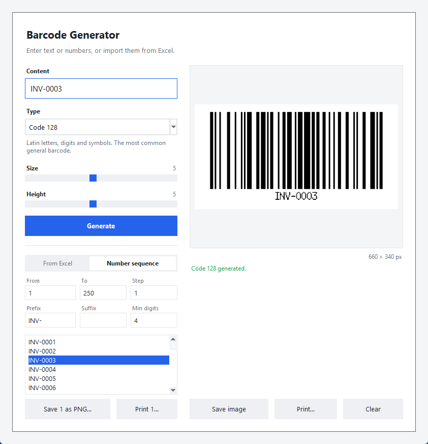
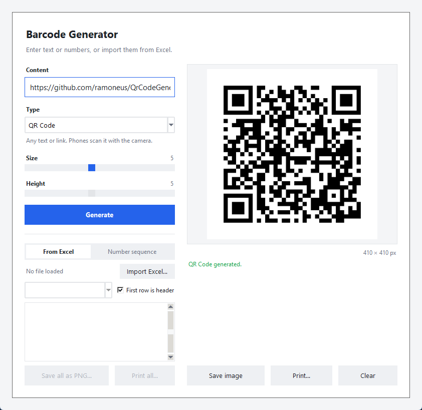

<h1 align="center">Barcode Generator</h1>

<p align="center">
  A Windows desktop app that creates, batch-exports and prints QR codes and 18 other barcode types.
</p>

<p align="center">
  <a href="https://github.com/ramoneus/QrCodeGenerator/releases/latest"><strong>Download for Windows</strong></a>
  ·
  <a href="#features">Features</a>
  ·
  <a href="#getting-started">Getting started</a>
</p>

<p align="center">
  <a href="https://github.com/ramoneus/QrCodeGenerator/actions/workflows/tests.yml"></a>
  
  
  
  
</p>

<p align="center">
  
  
</p>

## Overview

Online barcode generators make one code at a time and leave you to sort out the printing. This app is for the jobs that come after that: hundreds of inventory labels from an Excel sheet, a numbered run such as `INV-0001` to `INV-0250` for a sticker sheet, or a single QR code for a link.

It runs offline as a single `.exe`, with no installation and no account.

## Features

**19 code types**

| Group           | Types                                                    |
| --------------- | -------------------------------------------------------- |
| 2D              | QR Code, Data Matrix, PDF417, Aztec                      |
| Retail          | EAN-13, EAN-8, UPC-A, UPC-E, ISBN                        |
| Logistics (GS1) | GS1-128, ITF-14, GS1 DataBar, GS1 DataBar Expanded       |
| General         | Code 128, Code 39, Code 93, Interleaved 2 of 5, Codabar  |
| Pharma          | PZN                                                      |

- Each type shows a live example and a short hint about the data it accepts and where it's used.
- Check digits are added automatically. Invalid input gets a readable error instead of a broken code.

**Batch work**
- **Import from Excel:** load an `.xlsx` file, pick a column, and say whether the first row is a header.
- **Number sequences:** set From, To, Step, a prefix, a suffix and a minimum number of digits. For example, `INV-` with 4 digits gives `INV-0001`, `INV-0002` and so on, counting up or down.
- **Selecting values:** pick values with click, Shift+click, Ctrl+click or Ctrl+A. Saving and printing then use only the selection, or the whole list when nothing is selected.
- **Saving:** save every value as its own PNG in one go. File names are made safe and unique, and invalid values are skipped and listed.

**Printing**
- Print to any installed Windows printer, either one code per label (label printers) or a grid of columns and rows (sticker sheets).
- Choose how many copies of each code to print.
- The page size comes from the printer driver. Each code is enlarged by a whole number of pixels to fill the label.

**Output that scans**
- Bars are always whole pixels wide, so codes stay scannable at every size.
- Width and bar height are adjustable. The human-readable text under the bars is kept when you change the height.

## How it works

- **Generation:** QR codes are made with [`qrcode`](https://pypi.org/project/qrcode/). Every other type uses [`zxing-cpp`](https://github.com/zxing-cpp/zxing-cpp), the C++ port of the ZXing library. Its error messages are cleaned up before they are shown in the app.
- **Bar height:** zxing draws linear barcodes at a fixed height. The app finds the bars, which are the longest run of identical rows that mix black and white, and stretches only those rows. This leaves the text and the solid bearer bars of ITF-14 untouched.
- **Printing:** codes are drawn straight onto the printer's device context through the Windows API (`pywin32`) and scaled by nearest-neighbour. This keeps the edges sharp on low-resolution thermal label printers.
- **Structure:** all generation, Excel, sequence and printing logic is in [`main.py`](main.py), and [`gui.py`](gui.py) only handles the interface. The logic can therefore be reused from a script or the command line.

## Tech stack

| Area      | Choice                                    |
| --------- | ----------------------------------------- |
| Language  | Python 3.13                               |
| GUI       | Tkinter with a custom flat theme          |
| Barcodes  | zxing-cpp, and qrcode for QR codes        |
| Images    | Pillow                                    |
| Excel     | openpyxl                                  |
| Printing  | pywin32 (Windows GDI)                     |
| Packaging | PyInstaller, as a single-file `.exe`      |
| Testing   | pytest, run on Windows by GitHub Actions  |

## Getting started

### Download

Get **Barcode Generator.exe** from the [latest release](https://github.com/ramoneus/QrCodeGenerator/releases/latest) and run it. You don't need Python. Windows SmartScreen may warn about an unsigned app the first time you run it. Choose **More info → Run anyway**.

### Run from source

You need Python 3.11 or newer on Windows.

```bash
git clone https://github.com/ramoneus/QrCodeGenerator.git
cd QrCodeGenerator
pip install -r requirements.txt
python gui.py
```

On Windows you can also double-click **`Barcode Generator.bat`**.

To make a single QR code from the command line, run `python main.py`, enter a link, and the code is saved as `qrcode.png`.

### Build the .exe

Double-click **`Build exe.bat`**. It installs the dependencies and PyInstaller, then writes `dist\Barcode Generator.exe`.

## Tests

```bash
pip install -r requirements-dev.txt
python -m pytest
```

The pytest suite checks:
- **Every code scans.** Each of the 19 types is generated and then read back with a barcode reader, at several sizes and bar heights, and must decode to the expected text, check digit included.
- **Bar height.** The bars come out exactly as tall as requested, the text under them is unchanged, and the codes still scan.
- **Error messages.** Invalid input gives a readable error.
- **Sequences.** Prefixes, suffixes, leading zeros, counting down, steps and the 10,000-value limit.
- **Excel import.** Numbers stored as floats, leading zeros, blank cells, short rows and multiple sheets.
- **File names.** Values are turned into names that are safe on Windows.
- **Printing.** Codes are printed to *Microsoft Print to PDF*, and the number of pages is checked for each layout. These tests are skipped when that printer isn't installed.

GitHub Actions runs the tests on Windows for every push and pull request.

## Tips

- Numbers with leading zeros, such as `0123…`, must be stored as text in Excel. Otherwise Excel drops the zeros.
- For sticker sheets, set the paper size in the printer's settings in Windows, then match the columns and rows to the sheet.

## Roadmap

- SVG and PDF export for print shops
- Saved print layouts for common label sheets

## License

Released under the [MIT License](LICENSE).
